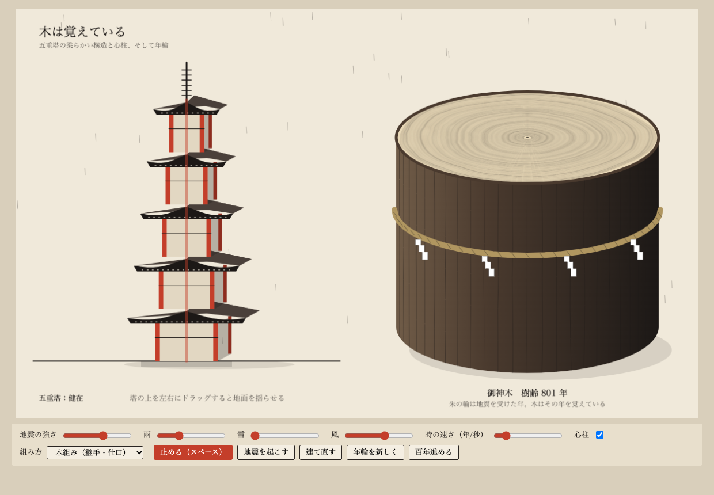

# p5 sketches

p5.js で作った作品を置くリポジトリ。1 作品 1 フォルダで `works/` に並べ、トップの `index.html` が一覧になる。ビルドの工程はなく、ファイルをそのまま GitHub Pages に出せる。

## 作品

### 木は覚えている



五重塔の柔らかい構造と心柱、千年かけて育つ年輪の作品。左の五重塔は地震・雨・雪・風を受けて揺れ、右の丸太は心柱の木で、時が経つと年輪が一本ずつ増える。その年に受けた地震は朱の輪とひびになって残る。

- 五重塔は 5 つの層をばねでつないで毎フレーム計算している。木組み（継手・仕口）にすると層の間がしなって揺れを吸い、倒れない。釘で固めると硬くなり、同じ揺れで傷み、やがて倒れる。
- 心柱をオンにすると、各層が勝手に暴れないよう全体の平均へ引き寄せる。心柱が揺れを抑える仕組みにはいくつかの説があり、ここではその考え方を絵にしている。
- 雨や雪は深い軒に当たると外へ流れる。
- 年輪は雨の年に太く、雪や嵐の年に細る。木が太るほど 1 年の輪は細くなり、千年で断面がいっぱいになる。樹齢 500 年を超えると御神木になり、幹に注連縄と紙垂が付く。

場所: [`works/ki-wa-oboete-iru/`](works/ki-wa-oboete-iru/)

#### 操作

| 操作 | 内容 |
|---|---|
| スペースキー / 画面のクリック | 始める・止める（止まっているときは画面の真ん中に案内が出る） |
| 塔の上を左右にドラッグ | 手で地面を揺らす |
| e | 地震を起こす |
| s | 画面を PNG で保存する |
| f | fps と 1 フレームの描画時間を表示する |
| スライダー | 地震の強さ、雨、雪、風、時の速さ（最大で毎秒 60 年） |
| 心柱・組み方 | 心柱のありなし、木組みと釘の切り替え |
| ボタン | 地震を起こす、建て直す、年輪を新しく、百年進める |

URL に `?age=800` を付けると、その樹齢から始まる。

macOS の「視差効果を減らす」（Windows の「アニメーション効果」オフ）が有効なときは、止めた状態で開く。

## 動かす

Node.js 18 以降があればよい。依存パッケージは無いので `pnpm install` は要らない。

```sh
pnpm dev        # 一覧ページをブラウザで開く。ファイルを保存すると自動で再読み込みする
```

| コマンド | 内容 |
|---|---|
| `pnpm dev` | 開発サーバーを起動してブラウザを開く（http://localhost:5173） |
| `pnpm start` | 起動だけ。ブラウザは開かない |
| `pnpm dev:host` | 同じネットワークのスマートフォンなどからも見られるようにする |
| `pnpm dev --port 5174` | ポートを変える |
| `pnpm new <slug> "<題名>"` | 新しい作品のひな形を作り、一覧に載せる |
| `pnpm capture [slug]` | 作品の画面を撮り、`works/<slug>/capture.png` に保存する（一覧と README の画像） |
| `pnpm check` | スクリプトの構文を調べる |

一覧ページは `works.json` を読むので、`index.html` を直接ファイルで開くと一覧が出ない。`pnpm dev` から開く。作品のページはファイルで直接開いても動く。

## 構成

```
.
├── index.html          # 作品の一覧（works.json から作る）
├── works.json          # 作品の登録。題名・説明・撮影時の URL パラメーター
├── works/
│   └── ki-wa-oboete-iru/
│       ├── index.html
│       ├── sketch.js   # 作品本体（グローバルモード）
│       └── capture.png # pnpm capture で撮った画面
├── lib/
│   └── p5-2.4.0.min.js # p5.js 本体。全作品で共有する
├── scripts/
│   ├── capture.mjs     # ヘッドレスの Chrome で画面を撮る
│   └── new-work.mjs    # 作品のひな形を作る
├── serve.mjs           # 依存なしの開発サーバー
└── .nojekyll           # GitHub Pages で Jekyll を通さない
```

## 作品を足す

```sh
pnpm new hamon "波紋"     # works/hamon/ ができ、works.json の先頭に載る
pnpm dev                  # http://localhost:5173/works/hamon/ で書きながら確かめる
pnpm capture hamon        # 一覧用の画像を撮る
```

`works.json` の `summary` に一行の説明を書く。`capture` に `?age=800` のような URL パラメーターを書くと、撮影時にそれを付けて開く。

## 描画を軽くする決まり

作品を作るときに守っていること。

- `pixelDensity(1)` にする。Retina の既定は 2 で、塗る画素が 4 倍になる。
- `frameRate(30)` にする。動きの速さは 1 フレームの進みで合わせる。
- タブが裏に回ったら `noLoop()` で止める。
- 何度も描き直さないもの（年輪など）は `createGraphics()` に描いて取っておき、変わった分だけ描き足す。
- 粒の数には上限を付ける。
- 画面に数値を出すときはキャンバスに描かず HTML の要素を使い、更新は 1 秒に 1 回にする。

## GitHub Pages で公開する

ビルドが無いので、ブランチのルートをそのまま公開できる。

1. リポジトリの Settings → Pages で、Source を「Deploy from a branch」、ブランチを `main`、フォルダを `/ (root)` にする。
2. 数分で `https://<ユーザー名>.github.io/p5-sketch/` に一覧が出る。

このリポジトリは今は非公開になっている。非公開のリポジトリで Pages を使うには GitHub の有料プランが要る。無料プランなら、公開リポジトリにしてから設定する。

## p5.js について

`lib/` の p5.js は 2.4.0。2.x では 1.x と引数が変わった関数がある（例: `bezierVertex`）。古い例をそのまま貼って動かないときは、[p5.js のリファレンス](https://p5js.org/reference/)で 2.x の書き方を確かめる。
